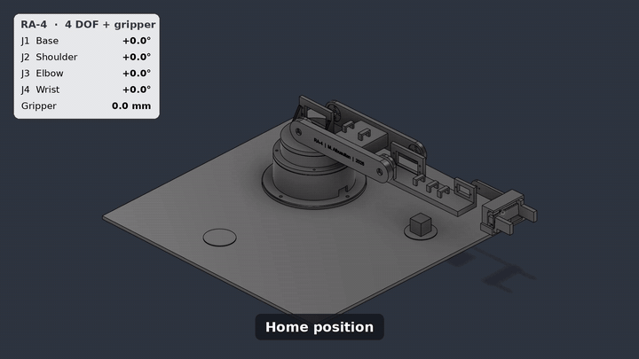
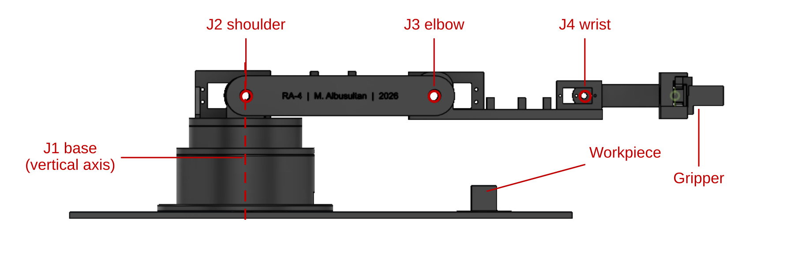
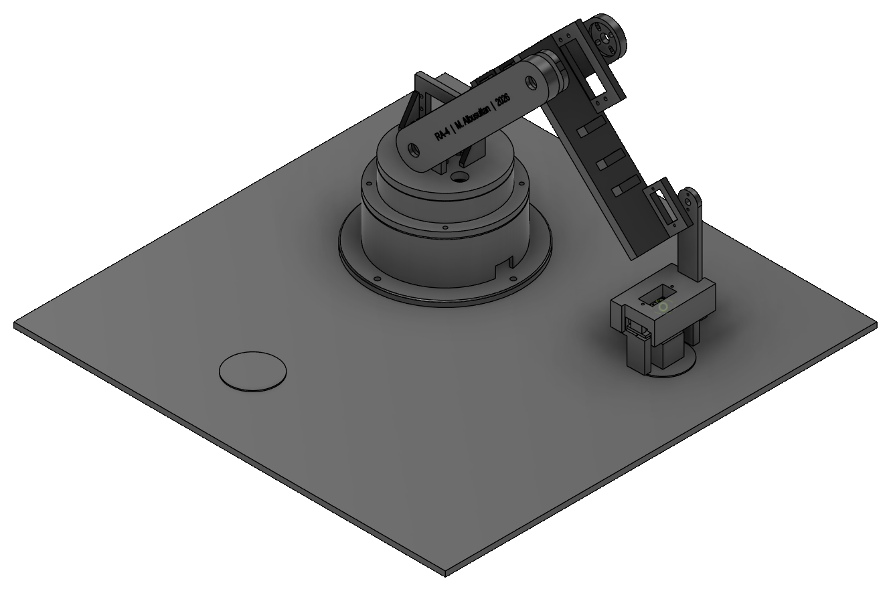
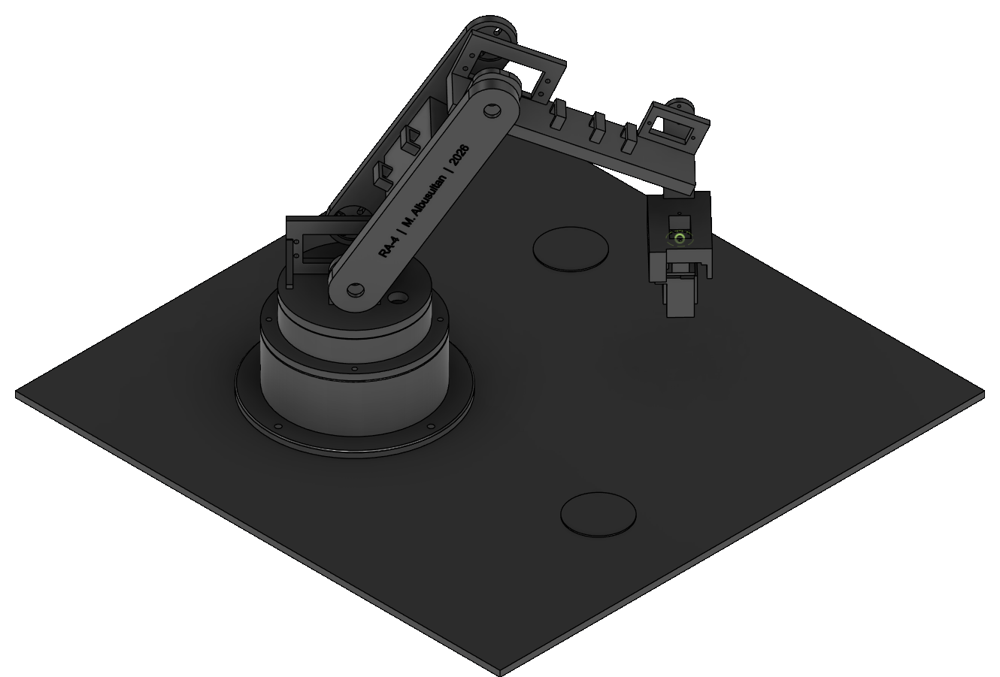
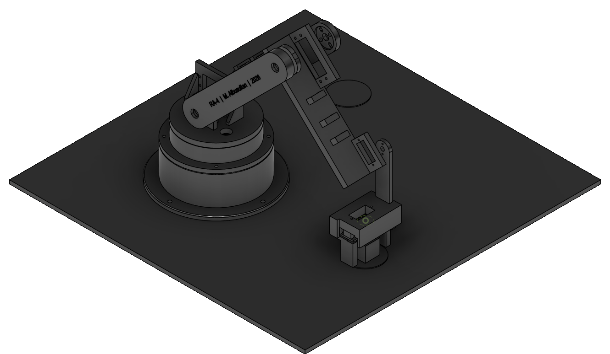
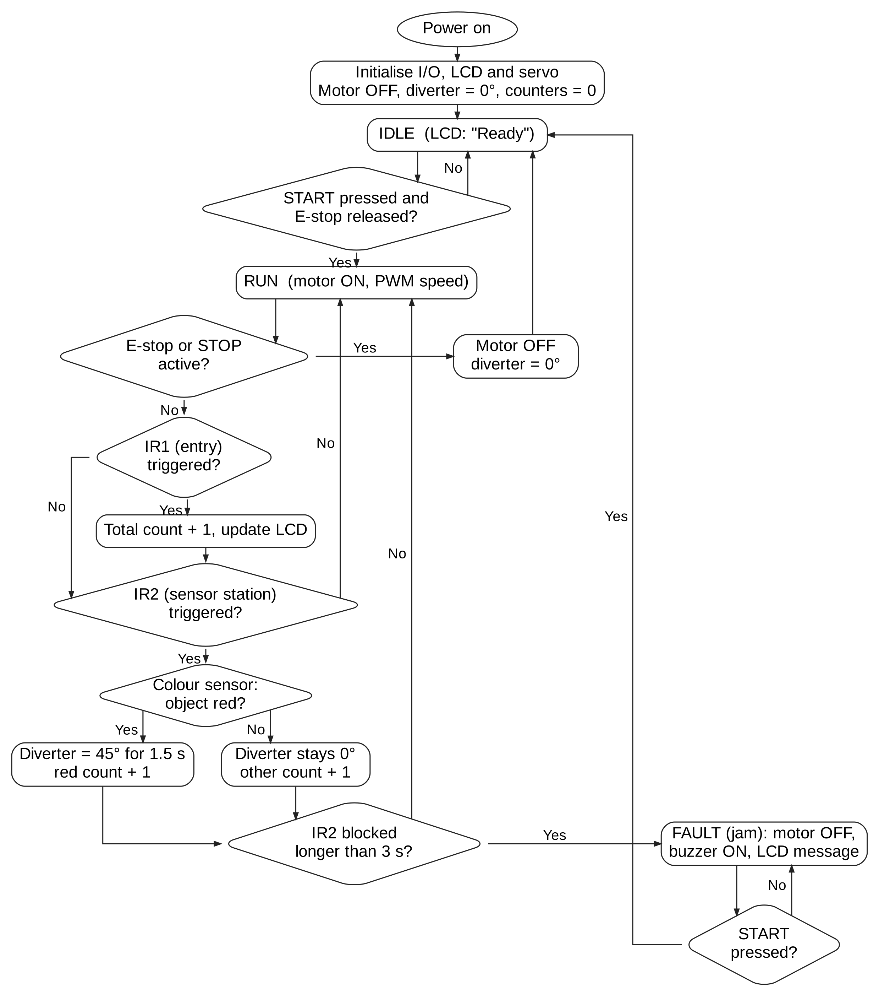
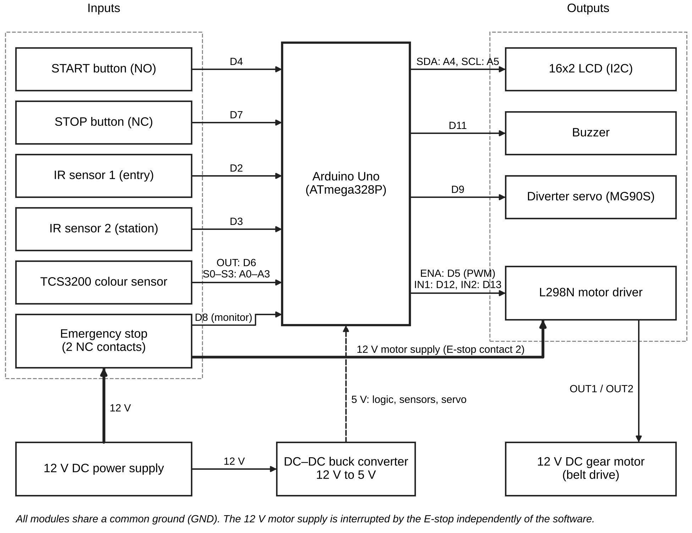
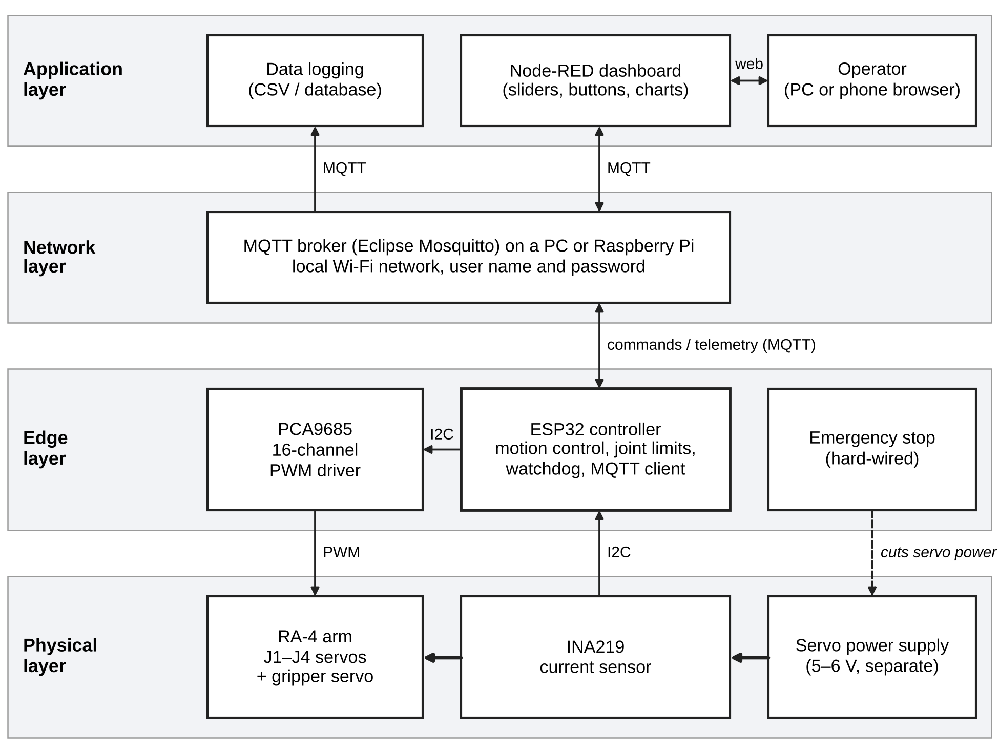

# CodeAlpha Robotics & Automation Internship – October 2026

**Mustafa Ali Mohsin Albusultan**
Mechatronics Engineering, University of Debrecen

This repository contains all four tasks of the CodeAlpha Robotics & Automation internship.

| Task | Topic | Main deliverable |
|------|-------|------------------|
| [Task 1](Task1_Research_Report) | Research report: Robotics in Manufacturing & Industry 4.0 | Report (PDF) |
| [Task 2](Task2_Robotic_Arm_Simulation) | Robotic arm simulation: RA-4, 4 DOF + gripper, pick-and-place in Autodesk Fusion | CAD files, screenshots, video, report |
| [Task 3](Task3_Automation_System_Design) | Automation system design: automated conveyor belt with colour sorting | Flowchart, circuit diagram, report |
| [Task 4](Task4_IoT_Mini_Project) | Mini project: IoT-based remote monitoring and control of the RA-4 arm | Proposal (PDF) |

---

## Task 1 – Research Report on Robotics Applications
**Robotics in Manufacturing and Industry 4.0**: industrial robot adoption, robot density by country,
collaborative robots, Industry 4.0 technologies, safety standards and challenges, with references.

📄 [CodeAlpha_Task1_Robotics_in_Manufacturing.pdf](Task1_Research_Report/CodeAlpha_Task1_Robotics_in_Manufacturing.pdf)

## Task 2 – Robotic Arm Simulation (RA-4)
A 3D-printable desktop robotic arm designed in **Autodesk Fusion**, with joint limits, motion links and a
pick-and-place **motion study**.

*Animated preview. Full-quality video (MP4, 39 s): [RA4_motion_study.mp4](Task2_Robotic_Arm_Simulation/Video/RA4_motion_study.mp4) – click “View raw” to download and play.*

**Degrees of freedom: 4 DOF + gripper**

| DOF | Joint | Axis | Range (model) |
|-----|-------|------|---------------|
| 1 | J1 – base rotation | vertical | −135° to +135° |
| 2 | J2 – shoulder | horizontal | −30° to +150° |
| 3 | J3 – elbow | horizontal | −150° to +30° |
| 4 | J4 – wrist pitch | horizontal | −90° to +90° |
| – | Gripper (rack and pinion) | linear | 0–20 mm per finger |

| Pick | Transfer | Place |
|------|----------|-------|
|  |  |  |

📄 [Simulation report](Task2_Robotic_Arm_Simulation/CodeAlpha_Task2_RA4_Arm_Simulation.pdf) ·
📁 [CAD files](Task2_Robotic_Arm_Simulation/CAD) · 🎬 [Simulation video (MP4)](Task2_Robotic_Arm_Simulation/Video/RA4_motion_study.mp4)

## Task 3 – Automation System Design
**Automated conveyor belt with sensor-based colour sorting** (Arduino Uno, IR sensors, TCS3200 colour sensor,
servo diverter, L298N motor driver, hard-wired emergency stop).

| Control logic | Circuit / block diagram |
|---------------|-------------------------|
|  |  |

📄 [Design report](Task3_Automation_System_Design/CodeAlpha_Task3_Automated_Conveyor_Design.pdf)

## Task 4 – Mini Project: IoT in Robotics and Automation
**IoT-based remote monitoring and control of the RA-4 robotic arm**: ESP32 edge controller, MQTT broker,
Node-RED dashboard, watchdog and current monitoring, implementation plan and evaluation.

📄 [Project proposal](Task4_IoT_Mini_Project/CodeAlpha_Task4_IoT_RA4_Proposal.pdf)

---

## Tools
Autodesk Fusion · Arduino · Graphviz · Python (matplotlib) · Microsoft Word

## License
© 2026 Mustafa Ali Mohsin Albusultan. Licensed under
[CC BY-NC 4.0](https://creativecommons.org/licenses/by-nc/4.0/): free to share and adapt with attribution,
not for commercial use. See [LICENSE](LICENSE).

#CodeAlpha
